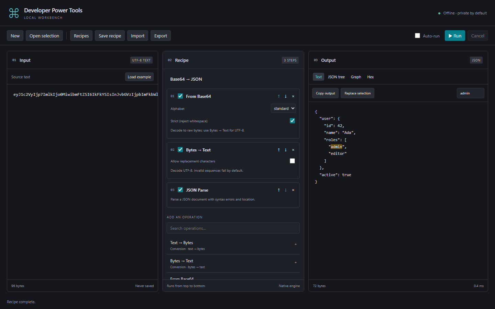

# Developer Power Tools

**An offline data workbench for Visual Studio Code.** Paste data or open an editor selection, build a recipe, and inspect the result as text, a JSON/YAML tree, a zoomable graph, or hex.

26 operations. Local processing. No telemetry or input persistence.



## Get started

Install the VSIX from [GitHub Releases](https://github.com/verisoftCZ/developer-power-tools/releases) using VS Code's **Extensions: Install from VSIX…** command. After Marketplace publication, the extension id is `verisoftcz.developer-power-tools`.

1. Run **Developer Power Tools: Open** from the Command Palette, or select editor text and choose **Developer Power Tools: Open Selection** from its context menu.
2. Paste input and add operations using the search box. **Load example** demonstrates Base64 → JSON.
3. Select **Run** or press **Ctrl/Cmd+Enter**. Choose Text, JSON tree, Graph or Hex to inspect output.
4. Copy the result or replace the original selection. Replacement checks the document version and supports editor Undo.

This is a **VS Code** extension. Windows may associate `.vsix` files with Visual Studio's installer; install through VS Code instead.

## What it does

| Area        | Operations and viewers                                                                                        |
| ----------- | ------------------------------------------------------------------------------------------------------------- |
| Encoding    | Base64 ↔ UTF-8 text or bytes, hex ↔ bytes, URL encode/decode                                                  |
| JSON        | Parse, pretty print, minify, unescape, decode escaped JSON fields, escape a whole document or selected fields |
| YAML        | YAML ↔ JSON; inspect YAML directly in the tree or graph                                                       |
| Inspection  | JWT header/payload (optional Bearer prefix; **signature not verified**), SHA-256                              |
| Dates       | Unix timestamps and automatic/explicit date parsing; source/output timezones and DST validation               |
| Generation  | Cryptographically random UUID v4 GUIDs, count/case/braces options                                             |
| Compression | Binary-safe gzip compression/decompression with limits                                                        |

The graph supports **Ctrl/Cmd + wheel** zoom around the pointer, drag-to-pan, collapse, search, Fit and 100% controls, up to 1600% absolute zoom. Large graphs fall back to a bounded tree. Date output defaults to **Europe/Prague**, formatted as `dd.MM.yyyy HH:mm:ss`; ISO output and other zones are selectable.

See the [operation guide](docs/operations.md) for formats, parameters and JSON-field examples.

## Recipes and shortcuts

Add, parameterize, disable, reorder or remove recipe steps. Save recipes to user storage or `.vscode/powertools-recipes.json` in a trusted workspace. Import/export portable schema-version-1 JSON recipes; [example recipes](examples) are included. Recipes contain operation settings, not input data. CyberChef recipe compatibility is not promised.

| Action           | Windows/Linux | macOS       |
| ---------------- | ------------- | ----------- |
| Open selection   | Ctrl+Alt+T    | Cmd+Alt+T   |
| Run in workbench | Ctrl+Enter    | Cmd+Enter   |
| Copy output      | Ctrl+Shift+C  | Cmd+Shift+C |

Auto-run is opt-in for inputs up to 64 KiB. Unknown imported operations are preserved and must be disabled or replaced before execution.

## Privacy and limits

Transformations run on your extension host with bundled code: no telemetry, remote processing or runtime downloads. Input/output are held in memory and are not automatically persisted. Clipboard, file exports and editor replacement are explicit user actions. Remote/WSL workspaces run on their workspace extension host.

CPU-bound operations use disposable workers with cancellation and deadlines. Default limits are 10 MiB input/intermediate output, 10 seconds per run and 300 graph nodes. Configure `powertools.maxInputMB`, `powertools.timeoutMs` and `powertools.graphNodeLimit`. Preview is capped at 256 KiB; copying text uses the full result. Binary output requires an explicit text conversion before replacing editor text. Trees, YAML expansion and decompression have additional bounds.

Workers are not an arbitrary-code sandbox, heap limits are not a total RSS limit, and processing is not streaming. See [security design](docs/security.md) and [verification status](docs/test-plan.md). Report vulnerabilities privately using [SECURITY.md](SECURITY.md).

## Develop

Use Node 24, npm and desktop VS Code 1.99+. Open this repository root in VS Code.

```sh
npm ci
npm run verify
npx playwright install chromium
npm run test:e2e
npm run test:integration
npm run package
```

Press **F5** to launch an Extension Development Host. On headless Linux, use `xvfb-run -a npm run test:integration`. Set `VSCODE_TEST_VERSION=1.99.0` for the minimum host, or `VSCODE_EXECUTABLE` for an installed executable. Use `npm run format` before submitting changes. See [CONTRIBUTING.md](CONTRIBUTING.md), [architecture](docs/architecture.md) and [release instructions](docs/releasing.md).

CI is configured for Windows, Linux and macOS, VS Code stable/minimum-host integration, Chromium UI tests and package checks. Local verification is documented separately; remote CI results become available after the first push. VS Code for Web and virtual workspaces are unsupported; remote/WSL, screen-reader and full high-contrast release checks remain documented limitations.

## License

[MIT](LICENSE). The bundled YAML parser is ISC-licensed; see [third-party notices](docs/THIRD-PARTY-NOTICES.md). CyberChef is not bundled. Contributions follow the [code of conduct](CODE_OF_CONDUCT.md).
